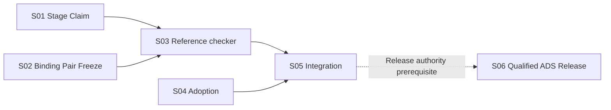

# ADS v4.12.0 — Core-first Version Task DAG Candidate R0

> **STATUS: TASK_DAG_CANDIDATE; NOT FROZEN, NOT MATERIALIZED.** This is the executable-source-owner **planning checkpoint** for the ADS *standards* release, **not** a generated application. It follows the recorded user-approved Architecture Owner L2 R5 Freeze in `docs/architecture/L2-FREEZE-v4.12.0-R5.md` (creation commit `5fdae14b006c350b82736f023efb6601dc373c21`), on frozen L2 blob `68608ef6456334d627db1797ba2e023233c84ce7`. The current planning branch is inherited from old main; **v4.11 predecessor is not Release-qualified**, so this is NOT the v4.12 adopted version integration baseline. Actual GitHub Task Issues/Dependencies, accepted CAS Claims, source PRs and Release gates remain separate. No Task state here overrides canonical live Issue state.

```ini
REPO=kaicreator-mm/ai-development-standard
VERSION=4.12.0
PRODUCT_R3_EXACT_BLOB=0bfbf782c8859e79df52c9b57904ad80bcd718e9
PRODUCT_FREEZE_CHECKPOINT=5820542ad1c092e09fae268f7e77a6db3421297b
L2_R5_EXACT_BLOB=68608ef6456334d627db1797ba2e023233c84ce7
L2_FREEZE_RECORD_COMMIT=5fdae14b006c350b82736f023efb6601dc373c21
L2_FREEZE_RECORD_BLOB=229ab659f5a437d80bfa123aae4ffe98e3e9d2a0
CURRENT_PLANNING_BRANCH=planning/v4.12-cross-stage-contracts-20261014
PLANNING_PR=#1101_DRAFT
QUALIFIED_PREDECESSOR_V411=NOT_VERIFIED
VERSION_BASELINE=CANDIDATE_ONLY_REBIND_TO_ACTUAL_QUALIFIED_PREDECESSOR
DAG_NODES=6
DAG_NATIVE_IMPL_EDGES=4
DAG_RELEASE_PREREQUISITE=S05_COMPLETE_WITH_QUALIFIED_OWNER_EVIDENCE
IMPL_TASK_NODES=5
RELEASE_OWNER_NODES=1
DAG_FREEZE=NOT_RECORDED
TASK_PACK_ADMISSION=NOT_RECORDED
NATIVE_TASK_ISSUES=NOT_MATERIALIZED
NATIVE_DEPENDENCIES=NOT_MATERIALIZED
IMPLEMENTATION_SOURCE_CLAIMS=NONE
ADS_RELEASE=NOT_QUALIFIED
```

## 1. Graph selection, dependency rationale and guardrails

This program uses **one ADS version work graph of five implementation Task concerns (S01–S05) and one existing Release-owner closure checkpoint (S06)**. A Product DAG-P/L2 DAG-A is historical/advisory evidence, not a second live issue scheduler. Exactly four non-transitive implementation dependency edges: `S01→S03`, `S02→S03`, `S03→S05`, `S04→S05`. `S05→S06` is the **preexisting version Release admission prerequisite**, not a fabricated fifth native implementation Task dependency. S01/S02/S04 can be readied in parallel after lawful Stage3 admission. S03 is the only checker owner. S05 is the only shared verifier/manifest/CI wiring owner. The qualified predecessor is a **separate version/integration admission**, not an invented native Task edge. **All normative writes** await that actual lawful version base and their own accepted Work Item/Claim, even if source-only planning is already possible.

- Work Item canonical types are `type:planning` (only authorized prospective *consumer pre-DF Scaffold* execution after adoption) and `type:task` (ADS version implementation). S01–S05 are ADS `type:task` implementation concerns. S06 is a separate version closure owned by the **existing `type:release` Work Item/Release Controller**; it is NOT a Builder-claimable implementation Task and cannot be self-approved. No application Scaffold is generated for ADS itself.
- Any actual material Task split or dependency rewrite after DAG Freeze needs existing Task DAG Governance `dag-mutation-record-v1`, authorized native GitHub dependency change, exact Task Pack binding and readback. Planning `Depends On` is never canonical live after materialization.
- Frozen PRD/L2 are **inputs**, not permission to override v4.11 baseline, original owner policy, signed human DENY, Stage2.6 Review selection, acceptance of a source-writing Claim or Release owner. Do not prematurely create READY Task Issues from this candidate.
- Stage-2 Frozen Architecture source first: adopt no Research Demo when existing exact owner files and isolated Git algorithm fact suffice to choose the design. Implement new missing checks in bounded Task scope and test them later, without pretending E1 equals a real GitHub native/Build Host/Release run.

## 2. Five implementation Tasks + one existing Release checkpoint

| ID | Primary owner invariant and intended file write set | Depends On | Concurrency | Required input / output | Focused acceptance and relevant negative | Risk / Review | Best executor / baseline | Required validation |
|---|---|---|---|---|---|---|---|---|
| **V412-S01** | **Stage/Claim authority:** `standards/DEVELOPMENT_WORKFLOW.md`, `standards/GITHUB_WORK_ITEM_CONTRACT_STANDARD.md`, `standards/GITHUB_AGENT_INTERACTION_PROTOCOL.md` **only affected prospective sections**; dedicated, unique `scripts/test_v412_phase_admission.py` if needed | — | YES vs S02/S04 (disjoint exact owner files) | Frozen PRD/L2 + current Work Item and Stage2.6 owners → adopted prospective phase order, source-writing Claim sequence and negative admission | Only `type:planning` for lawful prospective consumer pre-DF source; accepted CAS Claim before first file, correct Review before dispatch and public ABI review before SF acceptance; `NO_CLAIM_NO_EXECUTION` / lost ACK fail closed; no install/net side effects from writing package manifest; older pins unchanged | HIGH / **required** | High-reasoning Web docs author + local source verifier if actually needed; integration baseline **HOLD** until v4.11 qualified | Current owner-source clause parity; selected negative Claim/Review and no external-effect assertions; actual native CAS is NOT_RUN until eligible authenticated test |
| **V412-S02** | **Single binding/pair Freeze:** `standards/TASK_DAG_GOVERNANCE_STANDARD.md`, `templates/task-dag.md` only; dedicated `scripts/test_v412_pair_contract.py` if bounded static test required | — | YES vs S01/S04 | Frozen Product/L2, Task DAG Governance + Git object contract → canonical structural anchors, one Task-side effective binding with lawful SPLIT path, scope/exemption rules and pair Freeze record | Duplicate writer / orphan critical anchor / stale split binding rejected; no second mutable owner; explicit owner-approved exact exempt path only; all unknown Git material added/deleted/renamed paths HOLD; DF document exempt from **SF source view only** but never DF/MI validation; L2 semantic mismatch HOLD; no stub→feature PASS | HIGH / **required** | High-reasoning Web standard author + deterministic checker downstream; qualified implementation base required | Per-predicate explicit positive and negative contract examples, source currentness; executable checker acceptance delegated to S03 |
| **V412-S03** | **Pure reference checker:** uniquely `scripts/v412_scaffold_dag_check.py`, `scripts/test_v412_scaffold_dag_check.py`, new, uniquely named `references/v4.12/fixtures/v412_consumer_new_*` and `references/v4.12/fixtures/v412_consumer_mature_*` source-pinned cases **only where existing source fixtures insufficient**; the L2 research fixture `references/v4.12/fixtures/v412_l2_git_pair_probe.py` is **READ-ONLY frozen research provenance**. **Do NOT edit shared workflow, manifest, Golden index or other Task code.** | S01,S02 | YES vs S04 if still running with disjoint files | Exact S01/S02 accepted source and frozen L2, one fresh and one mature source-pinned test case → deterministic read-only forward/back indexes + pair truth report | 2 fixtures with exact source identity; Git object parsing NUL-safe including odd names/symlinks/gitlinks, file adds/deletes/renames, all unclassified material paths; owner-approved path exemptions; separate SF material view/DF/MI/generated output; malicious role whitelist, stale DAG, source lock/CI/anchor drift, duplicate writers, forged output rejected; machine evidence not auto-GitHub Claim | HIGH / **required** | Coding agent on eligible real Build Host for focused Python+Git; Web author may do source-only contract review | `python -B scripts/test_v412_scaffold_dag_check.py` on actual exact HEAD, log exit/skip and fixture IDs; no redundant full suite before integration |
| **V412-S04** | **Adoption and examples:** `standards/PROJECT_ADOPTION.md`, selected **unique** `templates/`/guide/checklist surfaces excluding `templates/task-dag.md` and all S01/S02 files; no shared Golden index/manifest | — | YES vs S01/S02; may overlap S03 only on read-only input | Current pinned adoption A0–A4, Frozen Product/L2 → concise new vs mature workflow, A0/A1 manual exact Git source predicate method, A2+ actual checker method; reuse Golden templates | Legacy pin untouched; manual `NOT_RUN` never PASS, `NOT_APPLICABLE` reasoned; Fast Path no empty DAG or mandatory Scaffold; optional Project Steward/Environment/Task Learning reuse v4.11 owners without second controller or service; generated app never ADS version Release | MEDIUM / **recommended** subject to real pre-dispatch owner policy | Web author with own accepted Claim and exact eligible base | Diff-level links/owners & template consistency and real-fact adoption negative, targeted docs checks only |
| **V412-S05** | **Central ADS standards conformance:** EXCLUSIVE `standard-manifest.json`, `scripts/verify_standard.py`, `templates/GOLDEN_INDEX.md`, and applicable `.github/workflows/verify-standard.yml` + shared test registration, plus narrowly version docs. Do not rewrite sibling substantive source | S03,S04 | NO for central shared writes; otherwise prepare read-only impact in parallel | Actual source-current merged outputs from S01–S04 → one integrated ads standard check and reusable exact assertion evidence | Existing Golden/manifest/schema parity, owner/gate/currentness negative cases; link two internal fixtures and no spurious other-app Release; no shallowed-history inherited false regression: reuse existing v4.11 #1038/PR #1040 `fetch-depth:0` only by legally qualified lineage; one chosen full candidate regression not repeated per Task | HIGH / **required** | Integration Builder on actual accepted base with deterministic CI | Scoped checks and actual current-HEAD CI; any unresolved E3/Hidden/real gate flagged NOT_RUN, not promoted |
| **V412-S06** | **Existing `type:release` closure owner, NOT `type:task`:** existing `standards/RELEASE_STANDARD.md` and existing controller; exact version integration, release docs/tag/baseline under Release authority only, **no new release Gate/service** | S05 **as Release-owner prerequisite, not a native Implementation Task edge** | NO | Qualified v4.11 predecessor + latest actually merged S05 ADS source and owner proof → current candidate / actual release decision | Owner-binding current Git tree, Release-owned visible/Hidden/E3/Critical Journeys/packaging as applicable; genuine Review; no skipped/UNKNOWN promoted to PASS; formal v4.12 tag only after Release Qualification; consumer/fixture PASS separate | CRITICAL / **Release-owned evidence/admission** (NOT a Task/PR Review Policy; any actual associated source-changing PR separately resolves its own canonical Review Policy) | Version Controller + qualified Build Host/independent Validator/Release owner, by applicable policy | Full version-owned closure on exact final source and genuine approval; if predecessor or mandatory proof unavailable, HOLD |

**Stage 2.6 policy normalization (R2 bounded repair):** Each **implementation Task S01–S05** records exactly one canonical Review Policy `required` or `recommended` for its eventual Task/PR. **S06 is a `type:release` owner checkpoint**, not an implementation Task; `Stage 2.6` does not make the Release Owner a Builder Reviewer. Any separate source-changing PR associated with release preparation independently resolves one canonical PR Review Policy; Release gate×subject approval remains owned by existing Release authority. This removes the earlier Task-vs-Gate conflation without adding a seventh work item or inventing any validation gate. This is author-side bounded design correction, not independent approval or legal DAG Freeze.

**R2 scoped write-set negative:** Frozen Architecture R5 adopts the already committed L2 E1 fixture as bounded **research evidence**, not a mutable official checker test source. S03 MUST create uniquely named consumer fixtures and MUST NOT edit or overwrite `v412_l2_git_pair_probe.py` as a shortcut; a material change to frozen L2 research evidence needs explicit currentness/owner disposition. This closes a broad `fixtures/**` write-scope collision without adding tasks or gates.

**File write precedence:** S01 controls Interaction/Workflow/Work Item; S02 owns DAG Governance and `templates/task-dag.md`; S03 owns new pure checker and targeted fixture paths; S04 owns Adoption and non-conflicting examples; S05 alone owns manifest/verifier/CI/Golden index. `standards/TASK_DECOMPOSITION_STANDARD.md`, generic reusable code-quality and v4.11 prior owners are **read-only reuse** unless exact demonstrated gap and lawful DAG amendment. Shared exact paths cannot be concurrently claimed.

## 3. Planning graph and lane summary



| Lane | Tasks | Entry prerequisites | Shared write restrictions | Converges at |
|---|---|---|---|---|
| Phase-owner | S01 | Frozen Product/L2, qualified implementation lineage, valid Task Claim | Only 3 affected normative owner documents | S03 |
| Binding-owner | S02 | Same | `templates/task-dag.md` exclusive; no S04 edits | S03 |
| Adoption-owner | S04 | Same | `standards/PROJECT_ADOPTION.md` exclusive; no S02/S05 central files | S05 |
| Checker | S03 | Accepted source outputs from S01/S02 | Own new script and scoped fixtures, no shared verifier | S05 |
| Convergence | S05 | S03 & S04 | Own all shared manifest, Golden index, CI and common verifier | S06 |
| Version closure | S06 | S05 & actual version qualification admission | Only Release controller can promote version gate | External adoption |

**Actual implementation integration target:** a lawfully created `version/v4.12.0` version branch based on **actual Release-qualified v4.11 integrated predecessor**, not the draft `planning/v4.12-...` PR based on v4.10-era `main`. Per-task branches must be created off that qualified target and merged after accepted scoped Reviews and exact-head evidence. Predecessor #1021 V01 remains BLOCKED/OPEN as of the last readback, so **source tasks are not READY** at this checkpoint. This blockage does not undo L2 Freeze or forbid source-only Task Pack authoring.

## 4. Task Pack materialization requirements and role admissions

An **implementation Task S01–S05** becomes executable only when its separately reviewed Task Pack / canonical native `type:task` Issue provides:
- exact Frozen Product R3 and L2 R5 refs plus current actual version base; ID, one concern, actual Issue ID after materialization, dependencies and native readback;
- allowed/forbidden writes, source conflict ownership, inputs/outputs, acceptance and negative validation, single applicable pre-dispatch Review Policy, risk/executor/environment constraints, L3 where required;
- real current READY admission, accepted CAS Claim (including claim generation/session provenance) **before** any source edits, and legal PR-level tests/Review/merge-ready at actual HEAD;
- one scoped failure-handling path if missing public contract, lost external-ack, stale Claim, current source mismatch, or unresolved Release owner: HOLD/REPLAN under existing protocol; no duplicate Issue/claim service and no acceptance from template text.

**Planned implementation Task→Issue pins:** `V412-S01..V412-S05` → `NOT_MATERIALIZED`; S06 → existing release-owned `type:release` workflow / version closure evidence `NOT_ADMITTED`. Do not create a sixth implementation `type:task` Issue for Release gate truth. Do not fabricate `#<id>` or native GitHub Issue Dependencies in a Markdown table. The controller must materialize **implementation Task** native relationships once the graph/pack are actually Frozen and the version branch is lawful; the GitHub native records then own live state.

## 5. Version evidence/closure separation

- **ADS product source acceptance:** this version's documents/rules/templates/reference checker in the qualified ADS repo, with internally executed one new and one mature *source-pinned fixture*. This is the **standard** acceptance subject.
- **Consumer reference fixtures:** isolated source trees/inputs used by checker. They are not separately developed/released apps and cannot generate native Claim/Review PASS or ADS Release PASS.
- **External project dogfood:** future projects may adopt the qualified ADS version by exact pin and project owner. Their actual releases are out of this ADS-version DAG and must not block ADS P0 standard closure unless a previously missed mandatory frozen Product predicate is genuinely discovered.

Only one bounded integrated final validation campaign per exact qualified ADS candidate, unless source change or previously uncovered gate genuinely requires a new run. Existing Release standards and enforcement may still require distinct real independent/Hidden/Host gates; source doc checks never satisfy those gates by wording.

## 6. Review, Freeze and next lawful steps

This DAG is **source-specific and ready for a single bounded exact-blob independent review only if the applicable DAG owner selects/requires it; otherwise a properly sourced DAG Controller acceptance is still needed**, not yet a Frozen Task DAG. On acceptance, the existing Task DAG Controller may freeze the **exact Git blob / checkpoint** with separate record. Then only materialize native Issues/Dependencies, Task Packs/Claims and implement source after a **lawfully qualified predecessor and eligible version branch**. Inability to access the native dependency API must be reported as BLOCKED and routed to a capable Local executor, not simulated by Markdown.

```ini
DAG_STATUS=COMPLETE_CANDIDATE_NOT_FROZEN
IMPL_TASK_NODES=5
RELEASE_OWNER_NODES=1
RELEASE_NODE_IS_NATIVE_TASK=NO
DAG_SOURCE_REVIEW=AUTHOR_SIDE_ONLY_NOT_INDEPENDENT
ARCHITECTURE_L2_FREEZE=PASS_EXACT_BLOB
VERSION_PREDECESSOR_QUALIFIED=NO_VERIFIED
NATIVE_TASKS_CREATED=0
TASK_CLAIMS=0
IMPLEMENTATION_SOURCE_CHANGED=NO
```
