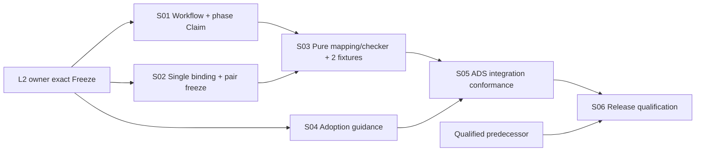

# ADS v4.12 — Core-first implementation Task DAG Draft R1 (source-owner projected)

> **Planning-only, NOT frozen and NOT implementation source-writing authority.** Product R3 blob `0bfbf782c8859e79df52c9b57904ad80bcd718e9` is frozen. L2 R5 blob `68608ef6456334d627db1797ba2e023233c84ce7` awaits **Architecture Owner exact-subject approval**. This file is the compact handoff for executing standards-first once existing Work Item / Claim / Review / version-baseline policies legally permit it. Do not materialize these IDs to native GitHub Tasks until the DAG itself is frozen; do not claim execution because this draft exists.

## 1. No-reimplementation decisions backed by existing pinned source

| Existing owner and exact candidate blob | Already authoritative | v4.12 small delta |
|---|---|---|
| `standards/DEVELOPMENT_WORKFLOW.md@28c537e12c03f3f0cef501b8b5505e8ee28ca532` | Stage 1→2→Task/Implementation, Stage2.6 risk-based Review; optional research demo | Conditional phase P/A worklists; **prospective** post-L2/pre-DAG `PLANNING_SCAFFOLD` under existing Claim, followed by paired planning Freeze |
| `standards/GITHUB_WORK_ITEM_CONTRACT_STANDARD.md@196f7d9372bcffd6ff801a70e1c1fffb204f4336` | Existing `type:planning`, `type:task`, common executable Issue contract, `READY→CAS accepted Claim`, Allowed/Forbidden | Precisely one pre-DAG planning source concern type; source write still no-earlier-than accepted Claim, not a new Issue type |
| `standards/GITHUB_AGENT_INTERACTION_PROTOCOL.md@8c8fc74bd6deaf6987f6cf6d4e8e8e84c2692b75` | Accepted `DISPATCH_CLAIMED` Start Record, `NO_CLAIM_NO_EXECUTION`, Review/merge authority | Clarify phase-specific scaffold write authorization without any parallel lock/claim |
| `standards/TASK_DAG_GOVERNANCE_STANDARD.md@e2ecfdbf0cd79f750aff40276e46a59159465f78` | Planning DAG vs native live Issue Dependencies; `dag-mutation-record-v1` SPLIT/SUPERSEDE | Structural source anchors + single Task-side binding, derived/recomputed indexes and split invalidation |
| `standards/TASK_DECOMPOSITION_STANDARD.md@f7020234e4825e1ebc6d7e05d028e6a71e03b049` | Atomic concern, shared-write owner, contract/core/integration lanes, risk-based Review | **Reuse, no mandatory amendment** unless exact inconsistency discovered |
| `standards/PROJECT_ADOPTION.md@a8c2d7a01a3610d9444d17df614ec6cacf58b67e` | Immutable project standard pin and A0–A4 profiles with identical truth floor | Concise adopting-project version cutover, manual SF/DF proof and no generated-fixture requirement |
| `scripts/verify_standard.py@a6233b79f8b60594e79302eee1c0e1bb30d0eab0`, `scripts/test_work_item_contract_and_golden_templates.py@6b261aa70f3b6a8c5cbd112af2662efd6d4da6aa`, `scripts/test_task_dag_lane_parallelism.py@1000c2912c76dc5c3df2de6af845c9138d6f5346` | Existing manifest/schema, canonical labels, golden examples, DAG-lane tests | Add only one focused v4.12 checker/test registration where missing; no duplicate test engine or new universal Gate |

**Critical baseline:** These are **v4.11 candidate** Git blobs, not a claim that v4.11 was released. Qualified predecessor for actual v4.12 version branch remains a separate mandatory lineage decision.

## 2. Draft six-concern graph (ADS standards only, not a generated application)



`L2` and `BASE` are **external authority prerequisites**, not fabricated implementation Issues or native `blocked_by` edges. The diagram is an intended future graph only. Real execution edges exist solely after lawful frozen DAG materialization.

| Concern | Single coherent source write owner and intended files | Review risk (candidate; actual owner resolves before dispatch) | Acceptance and negative proof |
|---|---|---|---|
| **S01** Phase admission | `standards/DEVELOPMENT_WORKFLOW.md`, narrowly `standards/GITHUB_WORK_ITEM_CONTRACT_STANDARD.md`, `standards/GITHUB_AGENT_INTERACTION_PROTOCOL.md` | HIGH, **required** when material public Claim/phase contract changes | Stage 1/2 authority preserved; pre-DF work uses existing `type:planning` **only on adopted v4.12**; correct READY, accepted CAS Claim, resolved Review before source write; denied collision and denied `postinstall`/network effects. No new type/controller/Bootstrap human Gate. |
| **S02** Pair/binding contract | `standards/TASK_DAG_GOVERNANCE_STANDARD.md`, `templates/task-dag.md` only if exact gap; do **not** wholesale rewrite decomposition owner | HIGH, **required** for public multi-agent write-currentness | Structural Anchor has no independently writable owner; one current Task-side writer within Issue Allowed and outside Forbidden, native deps separate; SPLIT/SUPERSEDE rebind atomically; Product/L2/SF/DF triple agreement; immutable accepted-SF material scope and exact owner-classified exemptions; `UNKNOWN`=HOLD, source edits cannot self-exempt. |
| **S03** Reference mapper/checker | `scripts/v412_scaffold_dag_check.py` (or existing utility only if source-compatible), `scripts/test_v412_scaffold_dag_check.py`, **one** new-project and **one** mature-project source-pinned conformance fixture under existing test layout | HIGH, **required** if published as authoritative machine verifier | Pure deterministic read-only: immutable Git object identities, all tracked paths including adds/deletes/renames/symlinks/gitlinks, NUL-safe path handling; separate MV vs DF/MI vs generated output; stable forward/reverse bytes and one current writer; malicious preaccepted allowlist DENY; DAG-only successor maps stale HOLD; lock/CI/anchor/source mutation MATERIAL; no GitHub mutation or second lock. These fixtures do not ship as apps. |
| **S04** Adoption/docs | `standards/PROJECT_ADOPTION.md` and only affected `templates/`/checklists; reuse existing `templates/planning-amendment-issue.md`, `templates/task-issue.md`, `templates/GOLDEN_INDEX.md`; skip if exactly already satisfied | MEDIUM, **recommended**, with required if owner/public contract policy elevates | One practical new vs mature adoption path; A0/A1 valid manual per-predicate evidence; A2+ executed checker proof; `not-run` never PASS; DAG-P/A optional, no forced app scaffold on ADS itself; snippets point to single owner standard rather than duplicating it. |
| **S05** Integrated standards conformance | `scripts/verify_standard.py`, existing standard-manifest/golden index as truly necessary; one focused v4.12 test entry in existing verify workflow (only when absent), change notes | HIGH, **required** for conformance integration | S01–S04 exact accepted source; targeted negative tests run; one candidate full regression on qualified exact SHA (not once per evidence row); no inherited shallow-checkout false-regression: consume v4.11 #1038/#1040 `fetch-depth:0` via legal source inheritance; CI green alone is not final Release. |
| **S06** Version qualification | Existing Release Controller + version integration owner; no new app repository; exact version branch, changelog/release/adoption evidence through current process | CRITICAL, **Release authority**, not a Builder self-review | Actual v4.11 Release-qualified predecessor and v4.12 S05 integrated source, mandatory Release owned checks/source readback, explicit release decision; otherwise HOLD. A consumer test-app Release is never substituted for an ADS standard Release. |

**Minimal transitive reduction:** actual intended Task edges are `S01→S03`, `S02→S03`, `S03→S05`, `S04→S05`, `S05→S06` (five; no artificial direct `S01/S02→S05` because S03 already carries that precedence). External Architecture Freeze and qualified predecessor are gate/lineage prerequisites, not native Task edges. This reduces unnecessary dependency bookkeeping without changing executable order.

**Write-collision resolution:** S01 owns canonical source phase/Claim semantics and publishes stable acceptance surface before S03 checker; S02 owns single mapping/paired-freeze semantics; S04 may draft/read in parallel but cannot edit S01/S02-owned files (in particular S04 MUST NOT edit `templates/task-dag.md` while S02 owns it); S05 alone owns central `standard-manifest.json` / test registration so sibling tasks do not race. Task identities can be folded when an exact existing standard already satisfies an intended delta. Separate concern PRs only when truly independently mergeable; no automatic six-PR quota.

## 3. Candidate checker input/output minimum (not a new normative schema)

```text
Input: accepted SF Git commit/tree; frozen Product/L2 exact refs; current DF blob;
       versioned accepted-SF material-scope manifest + owner-classified exempt exact paths;
       structural anchors; Task-side canonical bindings; optional materialized Task↔Issue refs.

Derived: material-view digest MV over all non-exempt tracked Git objects;
         current DAG/semantic binding digest MI separate from DF checkpoint;
         deterministic forward Task→Anchor and reverse Anchor→Task views.

Reject/HOLD if:
  writer-chosen exemption without frozen L2/source owner eligibility;
  any unclassified/material drift between SF and first pair checkpoint;
  stale DF/MI, forged generated output, self-referential hash;
  dangling or duplicate material anchor; multiple active writers;
  missing Issue Allowed/Forbidden or accepted Claim for an authorized source write;
  public Product/L2 ABI/trust mismatch even when SF and DF agree;
  NotImplemented stub called FEATURE_USER_PATH_REACHABLE;
  unsupported real Claim/GitHub/Host/Release authority fabricated from local fixture.
```

**Evidence ladder:** (1) static text/owner consistency; (2) isolated E1 Git synthetic positives/negatives; (3) real GitHub Claim/Review/merge only if claimed and applicable, with actual durable events; (4) independent ADS Release validation. Treat each independently: no test fixture auto-promotes (2) to (3) or (4).

## 4. Review and version freeze sequencing

```text
Frozen PRD R3 (already evidenced)
→ exact L2 R5 Architecture Owner review/disposition
→ authorized L2 Freeze (exact blob, owner checkpoint)
→ qualified predecessor selection/current version branch
→ frozen, reviewed ADS-internal Implementation DAG (this draft adapted on real baseline)
→ canonical Issue materialization & native dependencies → READY / accepted CAS Claim
→ S01/S02 + S04 controlled source work → S03 checker → S05 integration
→ current bounded Review/Validation → S06 ADS Release qualification
→ external projects explicitly adopt qualified ADS pin and report feedback
```

**No legal shortcut by a user phrase '继续推进':** it initiates planning/work under existing permissions but is not by itself the exact scoped Architecture Owner Freeze, source Claim, or Release approval. Do not falsely create any such event.

## 5. What is already verified in GitHub vs missing

- Product R3 Source Freeze = **recorded**, exact blob `0bfbf782c8859e79df52c9b57904ad80bcd718e9`; pending architecture evidence R5 candidate `68608ef6456334d627db1797ba2e023233c84ce7`.
- v4.11 Work Item/CAS/Review, Decomposition, Golden/Schema and Task DAG Governance were **read at their exact blobs** and support bounded reuse, **not** claim of v4.12 implementation completion.
- Historic v4.12 synthetic Git research fixture = **12/12 author-reported E1**. The GitHub committed exact bytes have **not** been executed in this draft work; new-project/mature-project official v4.12 checker = **NOT_RUN**.
- ADS v4.12 standards changes / qualified merge / runtime conformance / release = **NOT_RUN**. No claim made of measured saved Host time or future external dogfood result.

## 6. Next exact owner decision

**One existing Architecture Owner decision, not a new mandatory Review loop or Issue:** read candidate L2 R5 blob `68608ef6456334d627db1797ba2e023233c84ce7`, Frozen PRD R3, this Task-DAG planning sketch, and v4.11 owner standards. Choose `APPROVE_L2_R5_EXACT_FREEZE` or a **single bounded correction with evidence** / `WITHHOLD`. Current ChatGPT Web author cannot grant its own Architecture authority by asserting that review already happened.

Once frozen, do not conduct further speculative architecture research unless a real new high-impact falsifier appears. Execute the ADS source work under existing work-item/Claim rights rather than creating another planning-only R6, a new owner service, a demo app or many synthetic PRs.
